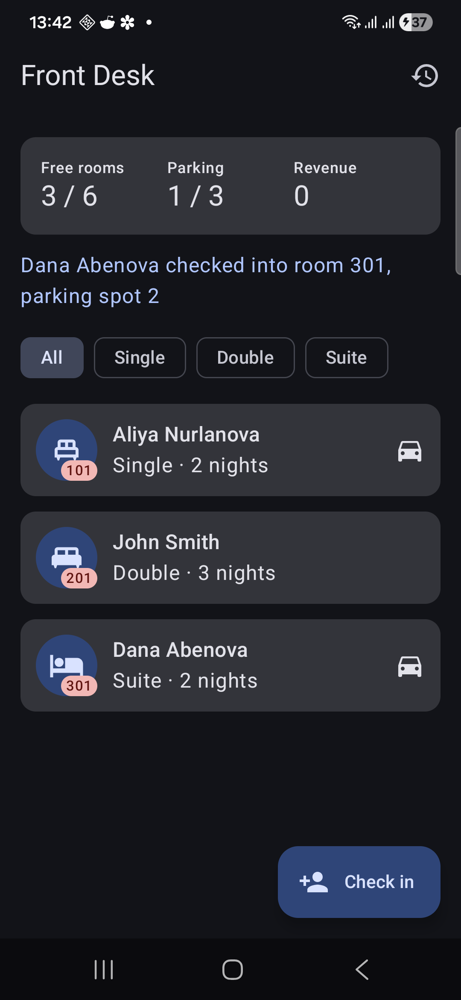
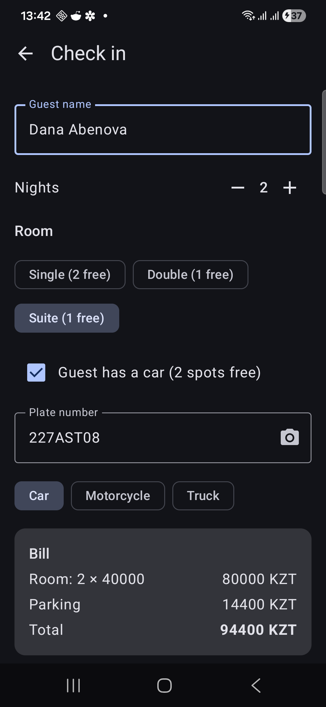
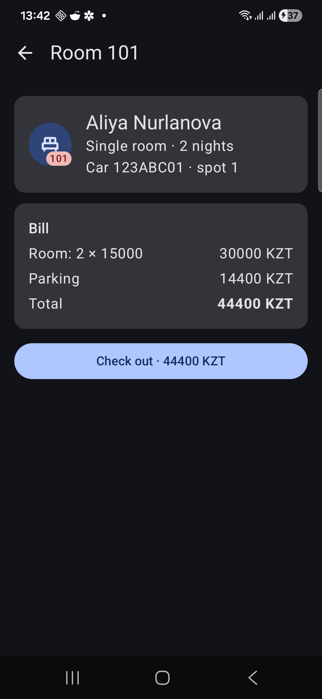
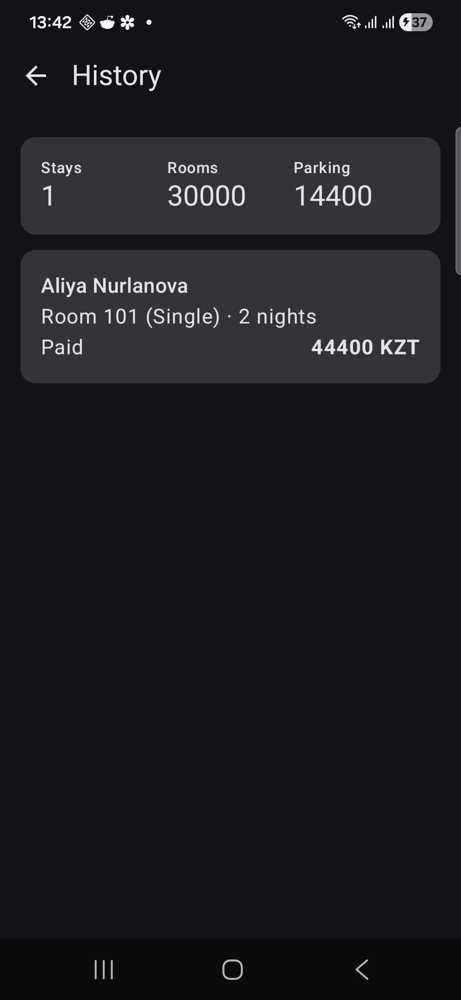

# Front Desk

An Android app for the reception of a small hotel with its own parking lot. The receptionist checks guests in, assigns a room and a parking spot for their car, and checks them out with one bill for the room and parking.

## Features

- **Dashboard:** free rooms, free parking spots and revenue; list of current guests, filtered by room type
- **Check-in:** guest name, nights, room type (with free rooms shown), optional car. The plate can be typed or scanned with the camera button (simulated). The bill is shown before check-in
- **Guest details and check-out:** room, car and parking spot, bill split into room and parking, check-out with payment
- **History:** past stays with revenue from rooms and parking

Rates: Single 15000, Double 22000, Suite 40000 KZT per night. Parking is charged for 24 hours per night: car 300, motorcycle 150, truck 600 KZT/h.

## How to run

1. Open the project folder in Android Studio.
2. Wait for the Gradle sync to finish.
3. Connect an Android phone with USB debugging enabled (Android 8.0 or newer), or start an emulator.
4. Press **Run ▶**.

## Screenshots

   

Dashboard after a check-in; check-in with a scanned plate; guest details with the bill; history after a check-out.

## Requirements

- Navigation Compose: `FrontDeskApp.kt` (`NavHost` with `dashboard`, `checkin`, `guest/{room}`, `history`)
- Architecture: `model/` (hotel and parking logic), `FrontDeskViewModel` (state), screens and `Components.kt` (UI)
- ViewModel: `StateFlow<FrontDeskUiState>` collected with `collectAsStateWithLifecycle()`, shared by all screens
- State hoisting: screens get `state` and callbacks; they don't use the ViewModel directly
- Reusable composables: `BackTopBar`, `StatsCard`, `StatItem`, `ChipSelector`, `Stepper`, `RoomIcon`, `GuestCard`, `BillLine`, `BillCard`
- Coroutines: `scanPlate()` runs in `viewModelScope` with `delay()`
- Kotlin: data classes, an enum, a sealed `CheckInResult`, inheritance (`Vehicle`), collections (`map`, `filter`, `sumOf`, `associate`)

## State on rotation

- `rememberSaveable`: the check-in form (name, nights, room type, car)
- `remember`: the check-in error message
- `ViewModel`: guests, history, revenue, filter, scanned plate
